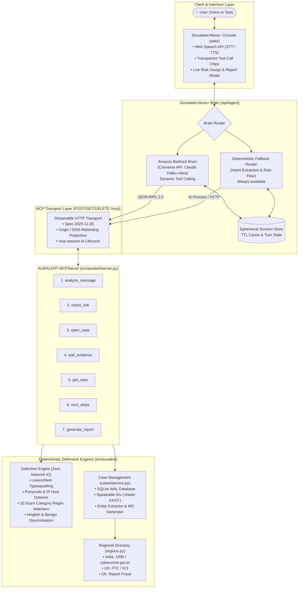
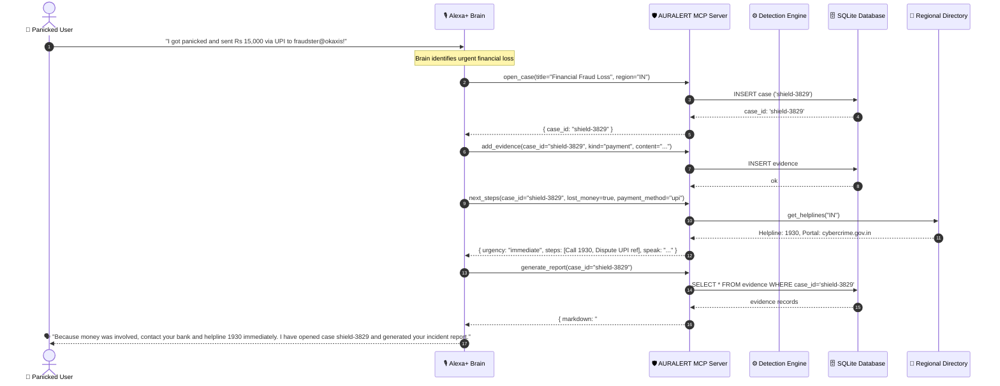

# Architecture & Technical Deep-Dive: AURALERT for Alexa+

> **Build, Ship, Shape: Amazon Developer Hackathon 2026**  
> **Track:** Alexa+ (Self-Hosted Model Context Protocol Server & Agent Brain)  
> **Mini-Challenges:** AWS Builder (Amazon Bedrock) & Open Source (MIT)

---

## 1. Executive Architecture Overview

AURALERT is a **voice-first defensive cybersecurity system** designed to protect consumers and vulnerable individuals from social engineering, phishing, and financial fraud. It acts as an intelligent intermediary between a voice assistant (Amazon Alexa+) and a suite of defensive cybersecurity tools exposed via the **Model Context Protocol (MCP)** specification (2025-11-25) over **Streamable HTTP**.



---

## 2. MCP Protocol Implementation (Streamable HTTP)

### 2.1 Spec Adherence (2025-11-25)
AURALERT implements the official Model Context Protocol using the Python MCP SDK (`mcp>=2.3.0`). In accordance with the latest protocol updates:
- **Transport:** Streamable HTTP at endpoint `/mcp` mounted into a Starlette / FastAPI ASGI application.
- **Methods:**
  - `POST /mcp`: Handles bidirectional JSON-RPC 2.0 client requests (`tools/list`, `tools/call`, `initialize`, `notifications/initialized`).
  - `GET /mcp`: Provides streamable event responses and protocol session negotiation.
  - `DELETE /mcp`: Gracefully cleans up active protocol sessions.
- **Session Identification:** Returned via `mcp-session-id` HTTP response headers.

### 2.2 DNS-Rebinding and Origin Validation
Per the MCP security recommendations, `OriginValidationMiddleware` intercepts all requests to `/mcp`:
```python
# Allowed Origins: localhost, 127.0.0.1, deployed domain, or empty (same-origin curl / direct clients)
if origin and not is_allowed_origin(origin):
    return Response(content="Forbidden: Invalid Origin", status_code=403)
```
In addition, `TransportSecuritySettings` guards against Host header forgery (`allowed_hosts=["localhost", "127.0.0.1", "testserver"]`).

---

## 3. The 7 Defensive MCP Tools

All 7 tools strictly enforce defensive cybersecurity boundaries. Every tool returns structured JSON with a short, voice-friendly string field (`speak`) limited to **at most 2 calm, actionable sentences**.

| Tool | Inputs | Primary Output | Voice-Friendly `speak` Purpose |
|---|---|---|---|
| `analyze_message` | `text`, `channel`, `region` | `verdict`, `risk_score` (0-100), `category`, `red_flags` | Immediate risk evaluation and primary action ("Hang up", "Do not share OTP"). |
| `check_link` | `url` | `verdict`, `risk_score`, `signals`, `normalized_domain` | Explains domain impersonation, Punycode, or fake login target. |
| `open_case` | `title`, `region` | `case_id` (e.g. `shield-2841`), `status` | Announces case tracking number in speakable phonetic format. |
| `add_evidence` | `case_id`, `kind`, `content` | `evidence_id`, `analysis` | Confirms receipt of message, call note, or suspicious link. |
| `get_case` | `case_id` | `case_id`, `title`, `evidence[]`, `timeline[]` | Returns full incident dossier and state. |
| `next_steps` | `case_id`, `lost_money`, `payment_method` | `urgency` ("immediate"/"today"), `steps[]` | Delivers golden-hour response actions (bank freeze, 1930 portal). |
| `generate_report` | `case_id` | `markdown`, `speak` | Synthesizes an evidence summary ready for police/cybercrime portal. |

---

## 4. Deterministic Rule-Based Detection Engine

### 4.1 Strict Zero-Network I/O Guarantee (No URL fetching)
Most commercial security scanners suffer from Server-Side Request Forgery (SSRF) and malware detonation vulnerabilities when visiting attacker-controlled URLs. AURALERT's detection engine runs **100% locally and offline**. It never makes network calls or DNS lookups on input URLs:
- Verified by automated unit tests monkey-patching `socket.socket` to throw a hard error if any socket connection is attempted during detection.

### 4.2 Link Analysis Pipeline (`link_checker.py`)
1. **URL Normalization & Parsing:** Strips tracking params, normalizes schemes, handles subdomains, ports, and whitespace.
2. **IP Host Detection:** Flags raw IPv4/IPv6 addresses used in SMS phishing (e.g., `http://192.168.1.5/login`).
3. **Punycode / Homoglyph Detection:** Flags IDN homographs targeting Latin lookalikes (`xn--...`).
4. **Levenshtein Typosquatting:** Evaluates edit distance against a curated dataset of over 20 global and Indian financial/technology brands (`brands.json`):
   - Example: `sbi-kyc-verify-portal.top` matches `sbi` (State Bank of India) with suspicious TLD `.top`.
5. **Risky TLD Matching:** Flags high-abuse TLDs (`.top`, `.xyz`, `.club`, `.work`, `.cam`, `.live`, `.loan`).
6. **Credential Harvesting Paths:** Regex checks for `/login`, `/verify`, `/kyc`, `/netbanking`, `/wallet`.

### 4.3 Message Analysis Pipeline (`message_analyzer.py`)
1. **Benign Automated Notification Discrimination:** Automated bank SMS alerts that contain warnings like *"Do NOT share this OTP with anyone"* are recognized as legitimate security notices (`risk_score = 5`, `verdict = "safe"`), preventing annoying false alarms.
2. **10 Curated Threat Categories:**
   - `digital_arrest`: Fake CBI/police video call threats.
   - `upi_collect_request`: PIN-entry deception for "receiving" money.
   - `kyc_otp`: Fake account freeze threats demanding verification.
   - `courier_customs`: Fake FedEx/DHL drug seizure parcels.
   - `gift_card_crypto`: Demands for Apple/Amazon gift cards or Bitcoin ATM deposits.
   - `tech_support`: Fake Microsoft/AnyDesk popups.
   - `fake_job`: High-yield Telegram review/task scams.
   - `bank_impersonation`: Card security traps.
   - `prize_lottery`: KBC / Lucky draw upfront fee scams.
   - `romance_investment`: High-yield bogus trading schemes.
3. **Hinglish Tokenization:** Seamlessly identifies colloquial Hinglish threat markers (`"account band ho jayega"`, `"turant verify karo"`, `"paise bhejo"`, `"kisi ko mat batana"`).
4. **Stable Red Flag Codes:** Emits explainable structured codes (`URGENCY`, `THREAT_OF_ARREST`, `ACCOUNT_SUSPENSION_THREAT`, `OTP_REQUEST`, `UNUSUAL_PAYMENT_METHOD`, `REMOTE_ACCESS_REQUEST`, `SECRECY_REQUEST`).

---

## 5. Case State & Storage (`cases/db.py`)

- **Engine:** SQLite with Write-Ahead Logging (`WAL` mode) for robust concurrency and sub-millisecond writes.
- **Schema:**
  - `cases`: Holds `case_id`, `title`, `region`, `status`, `created_at`, `updated_at`.
  - `evidence`: Compound primary key `(case_id, id)` with foreign key cascade deletion (`ON DELETE CASCADE`).
  - `timeline`: Auditable event trail for all tool operations.
- **Speakable IDs:** Generated via phonetic format `shield-XXXX` (where `XXXX` is a 4-digit number), ensuring that Alexa can read the ID aloud clearly without confusion.
- **Abuse Prevention:** Hard caps enforced at `MAX_EVIDENCE_PER_CASE = 50` and `MAX_CONTENT_LENGTH = 20,000` chars.

---

## 6. Simulated Alexa+ Brain & Fallback Router (`agent/`)

### 6.1 Amazon Bedrock Converse API
When AWS credentials (`AWS_ACCESS_KEY_ID`, `AWS_SECRET_ACCESS_KEY`) are present, the agent invokes Amazon Bedrock using the Converse API with a Claude Haiku-class model (`anthropic.claude-3-haiku-20240307-v1:0`):
- MCP tool definitions are dynamically converted into Bedrock `toolSpec` JSON schemas via `mcp_to_bedrock_tools()`.
- Bedrock autonomously orchestrates tool calls, parses results, and synthesizes empathetic, voice-first responses.

### 6.2 Deterministic Rule-Based Fallback Router
Hackathon demos and production systems often fail when external cloud LLM APIs experience rate limits, latency spikes, or credential issues. AURALERT solves this with an **automatic zero-downtime fallback router**:
- If Bedrock fails, is disabled, or times out, the request is instantly routed to `handle_fallback_turn()`.
- Fallback router uses heuristic intent detection (URL presence, payment loss keywords, emergency triggers) to invoke MCP tools deterministically.
- Needs no cloud credentials or network, so the demo keeps working if Bedrock or OpenRouter are unavailable. The `brain` field of every response says which provider answered.

---

## 7. Interactive Sequence Diagrams

### 7.1 Urgent Payment Loss Sequence (Golden Hour Intervention)


