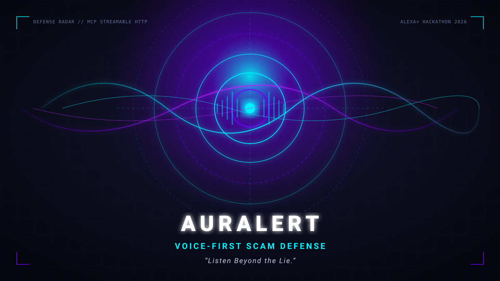

# Devpost Submission Text: AURALERT

> **Build, Ship, Shape: Amazon Developer Hackathon 2026** | **Track:** Alexa+ (self-hosted MCP server + simulated Alexa+ experience)  
> **Hackathon identity:** AURALERT — Built for the Alexa+ Hackathon.  
> **Mini-challenges:** Open Source (MIT).

### Project title
AURALERT — Voice-First Scam Defense

### Tagline (under 200 characters)
“Listen Beyond the Lie.” A voice-first scam defense tool that listens to suspicious calls, checks family safe words, links repeat-offender indicators, and prepares incident reports.

### Project description
AURALERT is a voice-first scam defense tool that listens to suspicious calls, checks family safe words, links repeat-offender indicators, and prepares incident reports. Built for Alexa+, it provides calm real-time second opinions to protect families and seniors against high-pressure digital arrest, UPI collect fraud, and impersonation scams.

### Inspiration
Scams cause losses estimated at roughly $1 trillion a year worldwide (Global Anti-Scam Alliance, *Global State of Scams* 2024). In India, "digital arrest" calls, fake KYC texts, and UPI collect tricks target families, especially seniors, who panic and cannot easily inspect a lookalike link or remember which helpline to call. We asked: what if a voice assistant could be the calm second opinion in the room?

### What it does
1. **Instant voice triage:** describe a call or paste a message or link; get a calm verdict (safe / suspicious / likely scam) in at most two spoken sentences, leading with the safest action.
2. **17 MCP tools** over Streamable HTTP: `analyze_message`, `check_link`, `open_case`, `add_evidence`, `get_case`, `next_steps`, `generate_report`, `notify_family`, `start_drill`, `score_drill_response`.
3. **Case file and report:** evidence is stored under a speakable case ID (for example `shield-482`); `generate_report` produces a complaint-ready summary with region-specific official channels (India, US, UK).
4. **Golden-hour guidance:** if money was sent, the steps are reordered so the most time-critical action (contacting the bank and the national helpline) comes first.
5. **Scam drills for seniors:** a practice mode where a simulated caller pressures you and your reply is scored on whether you kept your OTP, refused payment, and hung up.
6. **Family alert (simulated):** drafts and logs an alert for a trusted contact; it does not actually send WhatsApp or SMS messages in this version.
7. **Static link analysis:** lookalike domains, punycode, IP hosts, shorteners, risky TLDs. Links are never fetched.

### How we built it
- **MCP server:** official Python MCP SDK, Streamable HTTP at `/mcp` with Origin and Host validation, mounted in a Starlette app with rate limiting and request-size limits.
- **Detection engine:** explainable rules and regexes for English and Hinglish across 11 scam categories, with benign-notice discrimination (a real bank OTP that says "do not share" is not flagged). See `docs/EVALUATION.md` for measured results and limits.
- **Agent brain ("simulated Alexa+"):** Amazon Bedrock Converse API with tool calling (when AWS credentials are present), an optional OpenRouter brain, and a deterministic fallback router that keeps safety-critical flows reliable. Every response reports which brain answered.
- **Simulator UI:** voice in and out via the Web Speech API, live risk meter, case-file panel, and visible MCP tool-call chips. It is clearly labeled as a simulated Alexa+ experience, not an official Alexa client.
- **Quality:** 81 automated tests (detection, hardening, MCP transport, agent routing, scenarios) running on an isolated database.

### Challenges we ran into
- Keeping false alarms low: real bank OTP messages contain the same words as scams.
- MCP 2.x server APIs and DNS-rebinding protection (HTTP 421 errors) in test environments.
- Making a voice-first design: forensic detail goes on screen, while speech stays short and calm.
- Finding our own gaps: a review caught a tax-refund scam hidden behind a shortened link, which we fixed and added tests for.

### Accomplishments we're proud of
- A complete flow from voice triage to a complaint-ready report in one session.
- On a never-tuned 20-message evaluation set: no scam rated safe and no benign message flagged (17/20 strict); original 30-case benchmark 30/30. These are small hand-written sets, not production accuracy.
- Detection never touches the network, which a test enforces.

### What we learned
Voice security needs restraint: say the one safest action first, and show everything else on screen.

### What's next
Real Alexa+ device onboarding, live reputation feeds for links, regional-language speech, real family notifications with consent, and direct integration with reporting portals.

### Built with
Python, Model Context Protocol, Starlette, FastAPI, Uvicorn, SQLite, Docker, JavaScript, Web Speech API, Pytest

### Product feedback (edit with your real experience)
- **MCP Python SDK:** [what was clear, what was confusing, e.g. 2.x server API changes and Host/Origin validation errors].
- **Amazon Bedrock:** [e.g. model access was gated and paid, so the Bedrock path is implemented but untested in the demo].
- **Alexa+ / hackathon docs:** [what you wished existed, e.g. a local Alexa+ MCP test harness].

### Judging criteria map
| Criterion | Evidence in the repo |
|---|---|
| Technical Implementation | MCP over Streamable HTTP with Origin validation, 17 tools, SQLite case state, optional Bedrock tool-use loop with session history, deterministic fallback brain, 81 tests, static-only link analysis |
| Design | Voice responses capped at two sentences with the safest action first, risk meter, case panel, transparent tool chips, accessibility labels |
| Potential Impact | Targets a widespread family-level harm, including seniors; region-aware reporting steps; scam drills for prevention |
| Quality of the Idea | Uses MCP as a protective layer against social engineering rather than just a data fetcher |

*Regional contact details are stored in `data/regions.json` and reflect official published channels as of October 2026 (UK: Report Fraud replaced Action Fraud in December 2025). Re-verify before relying on them.*
